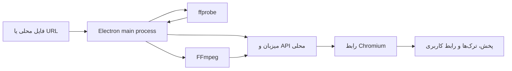

<div align="center">

# 🎬 Lumen Video Player

### پخش‌کنندهٔ رسانهٔ ویندوزی با رابط Liquid Glass، پشتیبانی گستردهٔ رسانه و موتور FFmpeg همراه


[فارسی](#فارسی) · [English](#english) · [دانلود سورس R9](./Lumen-source-r9.zip)

</div>

> **محتوای این مخزن:** سورس Revision 9 هم به‌صورت پوشهٔ [`source/`](./source) و هم در فایل [`Lumen-source-r9.zip`](./Lumen-source-r9.zip) قرار دارد (هر دو یکسان و به‌روز هستند). بسته **EXE، نصاب یا خروجی build ندارد**؛ برای ساخت برنامه باید مراحل پایین را روی Windows اجرا کنید.

---

<a id="فارسی"></a>

## 🇮🇷 دربارهٔ Lumen

**Lumen** یک پخش‌کنندهٔ رسانه برای Windows است که رابط آن با HTML/CSS/JavaScript و میزبان دسکتاپ آن با Electron ساخته شده است. رابط مدرن Liquid Glass با امکان کار با فایل‌های محلی، نشانی‌های آنلاین، فهرست پخش و ترک‌های زیرنویس ترکیب شده است.

در نسخهٔ ساخته‌شده، **FFmpeg و ffprobe همراه برنامه** قرار می‌گیرند. اگر Chromium نتواند کدک یک رسانه را مستقیم پخش کند، Lumen از موتور رسانه برای تبدیل سازگارتر به H.264/AAC استفاده می‌کند. برنامهٔ نصب‌شده برای دریافت FFmpeg به winget یا نصب جداگانهٔ codec pack متکی نیست و هنگام اجرا موتور را دانلود نمی‌کند.

## ✨ امکانات

- 🎞️ **پخش محلی و آنلاین:** بازکردن فایل یا پوشه، پخش URL/stream و برخی جریان‌های HLS؛ دریافت متن clipboard در دیالوگ Open URL.
- 🧩 **سازگاری کدک:** بررسی رسانه با ffprobe و استفاده از مسیر remux یا تبدیل هنگام نیاز. پشتیبانی دقیق به فایل، پروفایل، عمق رنگ، رمزگذاری و وضعیت خود stream بستگی دارد.
- 🗣️ **زیرنویس:** ترک‌های داخلی و فایل‌های کناری، بارگذاری دستی، تأخیر زیرنویس، و پشتیبانی از زیرنویس‌های آنلاین/stream.
- 🌐 **تطبیق مقاوم‌تر زیرنویس کناری در R8/R9:** نام‌های فارسی و Unicode، رقم‌های فارسی/عربی، نام فایل متفاوت، پوشهٔ شلوغِ دارای یک رسانه و زیرپوشه‌های متعارف `Subs` بررسی می‌شوند. تطبیق اپیزودِ ناسازگار و موارد مبهم در پوشه‌های چندرسانه‌ای رد می‌شوند.
- 🎨 **تنظیم ظاهر زیرنویس:** فونت، اندازه، رنگ، ضخامت، سایه، دورخط، پس‌زمینه و محل عمودی؛ **Reset look** برای بازگرداندن تنظیم‌ها باقی است. نمونهٔ Preview از Settings حذف شده است.
- 🪟 **حالت‌های نمایش:** تمام‌صفحه، Mini player، Picture in Picture و Always on top.
- 📚 **فهرست و کنترل پخش:** فهرست پخش، جست‌وجو، ادامهٔ پخش، سرعت، صدا، تِم‌ها و کنترل‌های لمسی.
- 🖱️ **تعامل دسکتاپ:** منوی راست‌کلیک، میان‌برها و دیالوگ Open URL با Cut/Copy/Paste.
- ⌨️ **میان‌برهای تازه:** `PageDown` / `PageUp` رفتن به ویدیوی بعدی/قبلی (با چرخش دور فهرست) و `Delete` انتقال فایل در حال پخش به **Recycle Bin** و پخش فوری ویدیوی بعدی. اگر فهرست فقط یک آیتم داشته باشد، فایل حذف نمی‌شود.
- ⚡ **سبک و سریع:** رسم تجمیعی فهرست پخش، بدون ffprobe برای هر فایل هنگام شروع، حذف کامل لایه‌های شیشه‌ای نامرئی از رندر، حالت کم‌مصرف واقعی، و رفع باگ مسیر FFmpeg (`transcode_start`).
- 🩹 **رفع باگ زیرنویس (پاس تازه):** زیرنویس‌های داخل فایل (Embedded) به فهرست ترک‌ها نمی‌رسیدند (`_load` تعریف `self` نداشت) و انتخاب خودکارشان هم شکست می‌خورد؛ حالا ترک‌های داخلی پیدا، خودکار بارگذاری و با کناری‌ها ادغام می‌شوند. مسیر `/subtitle` هنگام تشخیص پس‌زمینهٔ موتور ۵۰۳ نمی‌دهد، SRTهای UTF-16 و Windows-1256 (رایج برای فارسی) درست decode می‌شوند، و fallback بدون ffprobe ایندکس واقعی stream را گزارش می‌کند. جزئیات: `docs/BUGFIXES-FA.md` (دور ۱۳).
- 🚀 **باز شدن سریع (پاس تازه):** تشخیص موتور FFmpeg به پس‌زمینه منتقل شد (قبلاً چند `spawnSync` و `reg query` روی رشتهٔ اصلی و *قبل* از ساخت پنجره اجرا می‌شد)، پنجره بلافاصله نمایش داده می‌شود و منتظر `ready-to-show` نمی‌ماند، پورت ثابت سرور محلی باعث استفادهٔ مجدد Chromium از کش و کد کامپایل‌شدهٔ رابط می‌شود، و `config.json` فقط یک‌بار خوانده می‌شود. جزئیات و اندازه‌گیری در بخش «Launch speed pass» همین فایل و `docs/BUGFIXES-FA.md`.

### فرمت‌ها و محدودیت‌ها

موتور FFmpeg به طیف وسیعی از containerها و codecها دسترسی می‌دهد، از جمله MKV، MP4/MOV، WebM، AVI، MPEG-TS، FLV، WMV، Ogg و MXF؛ و HEVC/H.265، H.264، AV1، VP9/VP8، MPEG، VC-1 و ProRes. فرمت‌های رایج زیرنویس شامل SRT، VTT، ASS و SSA است.

> فهرست بالا تضمین پخش هر فایل نیست. فایل خراب، ناقص، رمزگذاری‌شده یا دارای پروفایل/عمق رنگ نامعمول ممکن است به تبدیل طولانی یا پخش‌نشدن منجر شود؛ تبدیل 4K یا 10-bit نیز می‌تواند CPU زیادی مصرف کند.

## 🏗️ معماری در یک نگاه



## ⬇️ دانلود و ساخت از سورس

1. فایل [**Lumen-source-r9.zip**](./Lumen-source-r9.zip) را از این مخزن دانلود و Extract کنید.
2. وارد پوشهٔ `source` شوید.
3. در Windows فایل `build-windows-r9.bat` را اجرا کنید.

**پیش‌نیازها:** Windows x64، Node.js **22.12 یا جدیدتر** و اتصال اینترنت برای دریافت dependencyها و runtimeهای پین‌شده. **NSIS 3.x اختیاری است** و فقط برای ساختن فایل نصاب لازم است؛ اگر نصب نباشد بیلد باز هم موفق می‌شود، `Lumen.exe` پرتابل ساخته می‌شود و `Lumen-portable-1.0.0-r9.zip` هم برای اشتراک‌گذاری ساخته می‌شود. برای ساختن نصاب: `winget install --id NSIS.NSIS -e` (یا `choco install nsis -y`) و اجرای دوباره‌ی BAT؛ اسکریپت‌ها خودشان NSIS را در PATH، `NSIS_DIR`، پوشه‌های معمول و کلید رجیستری پیدا می‌کنند.

خروجی در پوشهٔ `build\r9\windows` کنار پوشهٔ `source` قرار می‌گیرد و شامل نسخهٔ قابل‌حمل و نصاب per-user است. فایل‌های اجرایی در ZIP سورس قرار ندارند.

### خطای TLS در دانلود

اگر Windows Schannel خطای `CRYPT_E_REVOCATION_OFFLINE` بدهد، BAT دانلود را با `curl --ssl-no-revoke` دوباره امتحان می‌کند. این retry فقط بررسی وضعیت revocation را دور می‌زند؛ بررسی زنجیرهٔ گواهی و hostname برقرار می‌ماند و SHA-256 پین‌شدهٔ بایگانی پیش از استفاده کنترل می‌شود. این مسیر برای دانلود FFmpeg و Electron در زمان build است، نه هنگام اجرای برنامه.

## 🧪 آزمون‌ها

از ریشهٔ پوشهٔ `source`:

```bash
node tests/test-sidecar-matcher.js
node tests/test-source-ui.js
node tests/test-zip.js
```

```bash
# jsdom فقط برای آزمون رابط لازم است و اختیاری است
npm install --no-save jsdom
node tests/test-keyboard-renderer.js
node tests/test-ui-smoke.js
```

- آزمون تطبیق و استخراج زیرنویس: **۸/۸**.
- بررسی ساختاری Settings، هم‌خوانی پل دسکتاپ، میان‌برها، حذف امن فایل، بیلد بدون NSIS/unzip، استریم زیرنویس، بارگذاری خودکار زیرنویس و تولتیپ یکپارچه: **۱۸/۱۸**.
- آزمون رابط بدون مرورگر (jsdom) برای `PageDown`/`PageUp`/`Delete` و عملکرد فهرست پخش: **۸/۸**.
- آزمون تعاملی رابط (پنل‌ها، تنظیمات، ولوم، جست‌وجو، میان‌برها، تغییر mode، تولتیپ، زیرنویس): **۱۸/۱۸**.
- آزمون بازکنندهٔ بایگانی بیلد (بدون unzip/7-Zip، بایگانی واقعی، ورودی `../` و ZIP64): **۸/۸**.
- گزارش جزئی و محدودیت‌های محیط در `source/tests/results-r9-source.json` ثبت شده است. BAT و نصب نهایی باید روی Windows واقعی هم اجرا و تأیید شوند.

## 📦 وضعیت Revision 9

R9 شامل اصلاح تشخیص زیرنویس‌های کناری و حذف Preview از Settings است و خطای Schannel در دانلود build را نیز پوشش می‌دهد. شناسهٔ ساخت: `r9-2026-10-04`. یک پاس اصلاحی (میان‌برهای `PageDown`/`PageUp`/`Delete`، رفع باگ پل FFmpeg و بهینه‌سازی عملکرد) و یک پاس رفع باگ زیرنویس روی همین سورس اعمال شده‌اند و ZIP به‌روز شده است.

## ⚖️ مجوزها

`package.json` مجوز برنامه را MIT اعلام می‌کند. FFmpeg 9.0.2 essentials مورد استفاده در build از Gyan.dev می‌آید و تحت **GPLv3** معرفی شده است؛ مجوز FFmpeg جدا از مجوز کد برنامه است. یادداشت‌های مجوز و محدودیت بررسی source متناظر در `source/vendor/ffmpeg/win-x64/NOTICE-FA.txt` قرار دارند. پیش از توزیع عمومیِ build همراه FFmpeg، الزامات مجوز و منبع متناظر تمام وابستگی‌ها را بررسی کنید.

## 📬 تماس

**Behnam Ehsani** · [Inbox.ehsani@gmail.com](mailto:Inbox.ehsani@gmail.com)

---

<a id="english"></a>

## 🇬🇧 English

**Lumen** is a Windows media player built with Electron and a web-based Liquid Glass UI. The built Windows app bundles FFmpeg/ffprobe and can route media that Chromium cannot decode through a compatibility remux/transcode path. Actual playback depends on the file, codec profile, bit depth, encryption, and stream integrity.

### Highlights

- **New keys:** `PageDown` / `PageUp` jump to the next / previous item (wrapping), and `Delete` moves the file that was playing to the **Recycle Bin** and immediately continues with the next item (never when it is the only item).
- **Lighter and faster:** batched playlist painting, no per-file probing at startup, invisible glass layers removed from the render tree, a real low-resource mode, and the FFmpeg bridge bug (`transcode_start`) fixed.
- **Subtitles fixed:** embedded tracks never reached the track list (`_load()` referenced `self` without declaring it) and auto-load gave up before the probe answered; sidecar files encoded as UTF-16 or Windows-1256 decoded to NUL-soup; the `/subtitle` route 503'd during the background engine scan instead of waiting. Internal tracks now load automatically and merge with sidecar tracks. See *Subtitle loading repair* in `source/README.md` and docs/BUGFIXES-FA.md (round 13).
- **Opens faster (new pass):** FFmpeg detection moved off the launch path (it used to run several blocking `spawnSync`/`reg query` calls on the main thread *before* the window existed), the window is shown immediately instead of waiting for `ready-to-show`, the local server keeps a stable port so Chromium can reuse its cache and compiled code between launches, and `config.json` is read once. See *Launch speed pass* above and `docs/BUGFIXES-FA.md` for details and measurements.
- Local files and folders, URL/stream input, playlists, and selected HLS streams.
- Embedded, sidecar, and online subtitles; R8/R9 improve Unicode/Persian filename matching, cluttered single-media folders, and common `Subs` folders.
- Subtitle font, size, color, shadow, outline, background, position, and delay controls. The Settings sample Preview is removed; **Reset look** remains.
- Fullscreen, Mini player, Picture in Picture, Always on top, keyboard/context-menu controls, themes, and touch interactions.
- No runtime FFmpeg download. The source-build BAT fetches pinned build-time archives and verifies their SHA-256 values.

### Build

Download and extract [`Lumen-source-r9.zip`](./Lumen-source-r9.zip), enter `source/`, then run `build-windows-r9.bat` on Windows x64. Requirements: Node.js 22.12+ and Internet access. **NSIS 3.x is optional** and only needed for the `Lumen-Setup` installer: without it the build still completes with the portable app plus a shareable `Lumen-portable-1.0.0-r9.zip`; install it with `winget install --id NSIS.NSIS -e` (or `choco install nsis -y`) and run the BAT again. Build output is created outside `source/` under `build/r9/windows`; this repository artifact itself contains source only, with no EXE or installer.

The BAT retries a Schannel download failure such as `CRYPT_E_REVOCATION_OFFLINE` with `curl --ssl-no-revoke`; certificate-chain/hostname validation and pinned SHA-256 checks remain in place. This is a build-time download fallback only.

### Tests and licensing

Run `node tests/test-sidecar-matcher.js` and `node tests/test-source-ui.js` from `source/` (8/8 and 13/13). The optional `node tests/test-keyboard-renderer.js` needs `npm install --no-save jsdom` and runs the real UI headlessly (8/8 + 12 interaction checks). The application license is declared MIT; the FFmpeg build is separately identified as GPLv3. Review the accompanying notices and corresponding-source obligations before redistribution.
